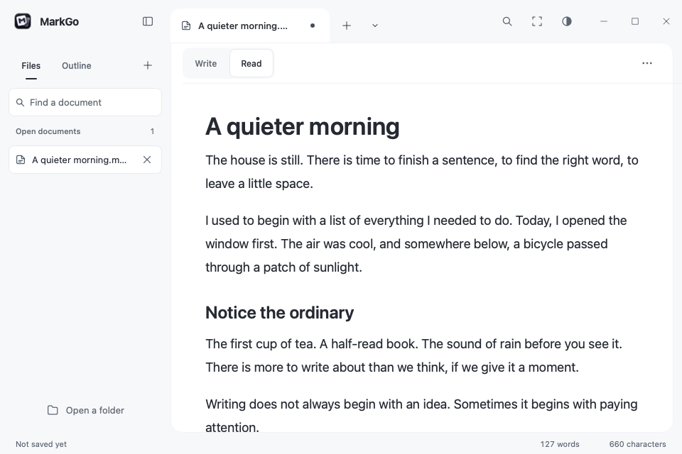

# MarkGo

[](https://github.com/xddcode/markgo/actions/workflows/ci.yml)
[](LICENSE)
[](go.mod)

**English | [简体中文](README.zh-CN.md)**

MarkGo is a free, open-source, local-first Markdown editor built with Go and [MyGo](https://github.com/egoist/mygo). Its fully drawn native interface uses no Electron runtime, WebView, or JavaScript layer.

Open a Markdown file or folder, write with source-preserving live preview, and use the outline, formatting controls, find and replace, or focus mode to work with your text.



*Rendered with MyGo's headless native UI renderer. This shows the reading view; editing keeps the original Markdown buffer.*

## Principles

- **Plain Markdown:** documents remain portable files, not a proprietary database.
- **Local-first:** core writing works without an account or a MarkGo server.
- **Native and focused:** a quiet writing surface, responsive interaction, and no required web runtime.
- **Free and open source:** no subscriptions, feature locks, advertisements, or telemetry.

## Writing

- Open, create, save, and save copies of UTF-8 Markdown documents.
- Browse a local folder, filter filenames, switch open documents, and navigate headings from the outline.
- Apply headings, bold, emphasis, inline code, links, lists, and quotes with undoable formatting controls.
- Continue ordinary lists, tasks, and quotes with Return; leave an empty item with another Return.
- Find and replace with case, whole-word, regular-expression, and selection options. Replace all is one undo step.
- Return to your previous documents and unfinished drafts; a first launch starts on a blank page.
- Search recent documents, keep drafts when closing, and recover completed local checkpoints after an interrupted session.
- Use source or live-preview editing, a formatted reading view, and focus mode.
- Switch between document tabs in a self-drawn title bar, with integrated window controls, a page toolbar and a compact file sidebar.
- Choose from 12 complete writing themes, including Sakura, Sage, Mist and Graphite, or follow system appearance.
- Adjust text size, Modern/Book typography, and page width; appearance preferences stay on your device.
- See word and character counts, modified-document markers, and external-file-change warnings.

The [writing guide](docs/writing.md) explains shortcuts, saving, and the difference between editing and reading.

## Current limits

Live preview hides supported Markdown delimiters while keeping one editable source buffer. It is not yet a complete Typora-style typesetting editor: headings use the editor's line metrics, and tables and images are formatted in **Read** mode while their source is edited in **Write** mode. Math remains TeX text.

Save is manual. Recovery keeps a separate local copy; it does not automatically save your Markdown files. Checkpoints are scheduled after a short pause, with a five-second maximum scheduling delay during continuous editing. Only completed writes can be recovered; see [recovery and recent documents](docs/writing.md#recovery-and-recent-documents). External changes are checked when the window regains focus and before saving. Save as creates a new file and refuses to overwrite an existing destination. Files must be regular UTF-8 files; symbolic links are rejected. New-file creation requires filesystem hard-link support. Edited documents with mixed line endings require an explicitly confirmed normalized copy.

AI features are deferred until the core writing experience is ready. The application does not connect to model providers. Platform-specific window, input-method, dialog, and packaging behavior needs native verification on each supported operating system.

See [ROADMAP.md](ROADMAP.md) for direction and non-goals.

## Build from source

Requirements: Go 1.27.4 or newer, Git, and a desktop platform supported by MyGo. Make is recommended for the shared quality commands.

```sh
git clone https://github.com/xddcode/markgo.git
cd markgo
go run ./cmd/markgo
```

Development and verification:

```sh
go tool mygo dev .
make check
make race
make security
go tool mygo build
```

See the [development guide](docs/development/setup.md) and [testing strategy](docs/testing/strategy.md).

## Documentation

- [Documentation index](docs/README.md)
- [Architecture](docs/architecture/overview.md)
- [Design system](docs/design/design-system.md)
- [Contributing](CONTRIBUTING.md)
- [Security policy](SECURITY.md)
- [Changelog](CHANGELOG.md)

## License

MarkGo is licensed under the [Apache License, Version 2.0](LICENSE). See [NOTICE](NOTICE) and [THIRD_PARTY_NOTICES.md](THIRD_PARTY_NOTICES.md) for attribution. The MarkGo name and logo are not licensed under Apache-2.0.
