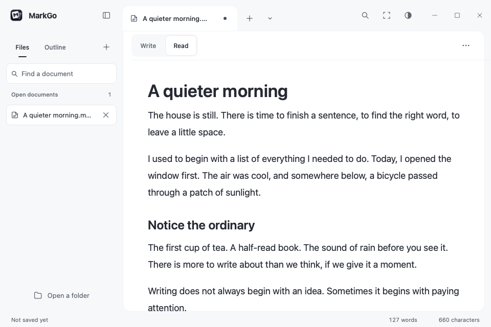

# MarkGo

[](https://github.com/xddcode/markgo/actions/workflows/ci.yml)
[](LICENSE)
[](go.mod)

**[English](README.md) | 简体中文**

MarkGo 是一款基于 Go 和 [MyGo](https://github.com/egoist/mygo) 的免费开源、本地优先 Markdown 编辑器。界面完全自绘，不依赖 Electron、WebView 或 JavaScript 层。

打开 Markdown 文件或本地文件夹，在保留源码的实时预览中写作，使用大纲、格式工具、查找替换和专注模式处理文稿。



*由 MyGo 无窗口原生 UI 渲染器生成。图中为阅读模式；编辑时仍使用原始 Markdown 缓冲区。*

## 项目原则

- **纯 Markdown**：文档始终是可迁移的普通文件，不绑定私有数据库。
- **本地优先**：无需账号或 MarkGo 服务器即可完成核心写作工作。
- **原生且专注**：低干扰写作界面、流畅交互，不强制携带 Web 运行时。
- **完全开源**：无订阅、功能锁、广告和遥测。

## 写作功能

- 打开、新建、保存 UTF-8 Markdown 文件，以及另存副本。
- 浏览本地文件夹、筛选文件名、切换文档，通过大纲跳转标题。
- 使用可撤销的格式工具设置标题、加粗、斜体、行内代码、链接、列表和引用。
- 按回车续写普通列表、任务和引用，在空项再次回车退出。
- 查找替换支持大小写、整词、正则表达式和选区范围；全部替换可一步撤销。
- 首次启动即是可输入的空白文档；后续启动恢复上次文档、编辑位置与未完成草稿。
- 搜索最近文档，退出时选择保留草稿；意外中断后恢复已完成的本地备份。
- 切换源码编辑、实时预览、排版阅读和专注模式。
- 使用多文档标签、自绘标题栏、页内工具栏和紧凑的文件侧栏，在不同文档之间保留各自的写作位置。
- 选择白纸、暖纸、樱花粉、鼠尾草、雾蓝、薰衣草、沙丘、珍珠灰、石墨、午夜蓝、松林、暮紫 12 套完整主题，或跟随系统外观。
- 调整字号、现代或书页字体、正文宽度；外观偏好保存在本机。
- 查看字词与字符统计、未保存标记，以及文件在外部被修改的提示。

[使用指南](docs/writing.md)介绍了快捷键、保存规则，以及编辑与阅读模式的区别。

## 使用限制

实时预览在同一份可编辑源码中隐藏部分 Markdown 标记，目前尚未达到 Typora 完整的即时排版体验：标题沿用编辑器的行高，表格和图片在 **Read** 模式中排版显示，在 **Write** 模式中编辑源码；数学公式暂以 TeX 文本显示。

Markdown 文件仍需手动保存。恢复副本单独保存在本机，不会自动覆盖原文档；停止输入片刻后开始备份，持续编辑时最长每五秒调度一次。只能恢复已经写入完成的内容。窗口重新获得焦点时及保存前会检查外部文件变化。另存为只创建新文件，不覆盖已有目标。文件必须是普通 UTF-8 文件，不支持符号链接；新建文件需要文件系统支持硬链接。编辑混合换行符文件后，需要明确确认另存为统一换行符的副本。

AI 能力推迟到基础写作体验完成之后，应用目前不连接模型服务。原生窗口、输入法、文件对话框和安装包行为需要分别在目标操作系统上验收。

项目方向和非目标见 [ROADMAP.md](ROADMAP.md)。

## 从源码运行

环境要求：Go 1.27.4 或更高版本、Git，以及 MyGo 支持的桌面平台。建议安装 Make 以使用统一的质量检查命令。

```sh
git clone https://github.com/xddcode/markgo.git
cd markgo
go run ./cmd/markgo
```

开发与验证：

```sh
go tool mygo dev .
make check
make race
make security
go tool mygo build
```

详见[开发指南](docs/development/setup.md)和[测试策略](docs/testing/strategy.md)。

## 文档

- [文档索引](docs/README.md)
- [架构概览](docs/architecture/overview.md)
- [设计规范](docs/design/design-system.md)
- [贡献指南](CONTRIBUTING.md)
- [安全政策](SECURITY.md)
- [更新日志](CHANGELOG.md)

## 许可证

MarkGo 使用 [Apache License 2.0](LICENSE)。署名与第三方声明请参阅 [NOTICE](NOTICE) 和 [THIRD_PARTY_NOTICES.md](THIRD_PARTY_NOTICES.md)。MarkGo 名称和 Logo 不以 Apache-2.0 许可授权。
