# Design system

## Direction

MarkGo should feel like opening a good notebook: a quiet page, clear type, and tools within reach. Its identity comes from proportion, spacing, the application's M icon, and consistent interactions. Keep the interface restrained: no decorative gradients, multicolored panels, or AI ornament.

The document is the visual center. Navigation supports writing; common formatting sits just above the page, with detailed controls in popovers. A first launch starts with an empty editable document; subsequent launches resume the prior session. Guides are available through the document menu.

## Workbench and typography

A 60 DIP self-drawn title bar holds the brand, document tabs and global tools. The active tab joins the page below; a 56 DIP page toolbar separates writing/reading mode from formatting. A 240 DIP sidebar holds Files/Outline, filtering, open documents, the folder tree and Open a folder. The theme's rail color surrounds the paper surface, whose outer corners use 16 DIP with a square tab-side top corner. A 12 DIP outer gutter keeps the page from touching the right window edge. A quiet 30 DIP footer reports actual save state, operation messages, caret position and counts.

The native title bar and caption buttons are hidden with MyGo's `TitleBarHidden` and `HideWindowButtons`. The OS frame remains responsible for resize edges, rounded corners, and shadows; do not switch to a borderless `Frameless` window. Blank title-bar space drags the window and supports MyGo's native double-click behavior. The custom maximize target registers with `MaximizeButton` for Windows Snap integration. The close action calls `Window.Close`, preserving the existing unsaved-document guard. All three controls remain available in Focus mode.

The header uses the existing application icon at 28 DIP and a 15 DIP MarkGo name. Document tabs are 224 × 48 DIP, with 12 DIP top corners, a 16 DIP file glyph, 13 DIP title and a reserved 40 DIP close target. Long titles ellipsize with full-path tooltips. A dirty dot occupies the close glyph's space until hover; the target never shifts. New-tab and All open documents controls follow the tabs, while global actions remain at the right. Overflow scrolls horizontally; the menu has a 480 DIP maximum height and distinguishes duplicate filenames by folder. Current tabs reveal after navigation or resizing without pulling back a user who intentionally scrolls the strip. Native tabs and menus retain their keyboard and accessibility models.

Files/Outline uses a short underline; selected files use a paper surface and theme-colored icon. Document and outline rows use 13 DIP text, secondary rail labels at least 11 DIP. Open a folder stays at the bottom. Footer counts use tabular figures and reserved widths.

The centered page defaults to 720 DIP maximum width, 18 DIP system text, and 1.85 line height. The writing area has 48 DIP horizontal and 38 DIP vertical breathing room. The editor has no line-number gutter or active-line background. Writers can choose 14–24 DIP text, system or serif type, and 640/720/840 DIP page widths. At the 960 × 640 minimum window, the page shrinks to fit.

Read mode uses a 1.9× first heading, 1.35× second heading, and 1.12× third heading, with 600 weight and intentional paragraph spacing. Quotes, rules, code blocks, and tables share the neutral palette. Read mode is a separate native Markdown view; editable headings still use fixed editor line metrics. Do not show a reading screenshot as proof of directly editable rich typesetting.

## Theme tokens

| Theme | Page | Sidebar | Ink | Secondary ink | Accent |
| --- | --- | --- | --- | --- | --- |
| Paper · 白纸 | #ffffff | #f7f8fa | #252932 | #5d6571 | #414b5a |
| Warm paper · 暖纸 | #fbf8f2 | #f3eee5 | #38342e | #675e52 | #77603f |
| Sakura · 樱花粉 | #fff8fa | #f7edf1 | #42343c | #715460 | #965471 |
| Sage · 鼠尾草 | #f7faf6 | #edf2eb | #303c32 | #536553 | #526e50 |
| Mist · 雾蓝 | #f6f9fc | #edf2f7 | #2d3948 | #536274 | #506e91 |
| Lavender · 薰衣草 | #faf8fd | #f1edf7 | #3c3547 | #665771 | #79628e |
| Sand · 沙丘 | #faf7ef | #f1edde | #3e392b | #625a42 | #796638 |
| Pearl · 珍珠灰 | #f6f7f7 | #edefef | #323b3c | #556163 | #536e70 |
| Graphite · 石墨 | #191b20 | #15171b | #e9ecf1 | #a6adba | #bcc6d7 |
| Midnight · 午夜蓝 | #18212c | #141b25 | #e4ecf5 | #a4b5ca | #a8c3e6 |
| Pine · 松林 | #1b2521 | #161f1b | #e4eee6 | #a7baab | #afcbb1 |
| Plum · 暮紫 | #26202b | #201a25 | #eee6f2 | #beabc8 | #cdb2da |

`internal/app/palettes.go` also specifies each palette's hover, pressed and border colors. Primary and secondary ink maintain at least 4.5:1 contrast on page, rail, hover and pressed surfaces. The accent is a restrained hue from that palette, reserved for primary actions, checks and keyboard focus. Selected text uses accent at 20% opacity; body text and syntax stay in neutral ink. Semantic warnings always include text. The system setting chooses Paper for light appearance and Graphite for dark appearance; explicit themes ignore system changes. Persist theme IDs, never catalog positions. Native dialogs use the chosen theme's light/dark appearance.

The 408 DIP Appearance panel uses a four-column gallery with 60 DIP cards: eight light themes above four dark themes. Each card shows its own paper and ink, with both a check and border for selection. Typeface and page-width segments sit on a recessed surface (10 DIP outer radius, 2 DIP padding, 8 DIP inner radius). All choices and typography controls fit the minimum window without scrolling. Opening the panel transfers keyboard focus into its controls without changing the writing selection. Tab traverses controls; Enter/Space activates a choice; Close or Escape returns to the writing caret.

The Appearance panel applies changes immediately to the whole client, including native-drawn menus, the editor, and reading view. Preferences are written atomically to the operating system's user configuration directory under MarkGo/appearance.json. No document contains appearance metadata. MARKGO_EPHEMERAL=1 bypasses loading and saving preferences.

## Icons and controls

The square application icon in resources/icon.png is configured in mygo.json and embedded for Window.SetIcon in both development and packaged builds. Keep at least 1024 × 1024 pixels so the same source can serve packaging and high-density displays. The interface icons in internal/app/icons.go are original vector drawings. The 24-unit control icons share 1.65-unit strokes, rounded joins, and rounded terminals; no emoji or font glyphs stand in for controls. Heading labels H1/H2 and textual search options retain their familiar notation.

Icon actions, formatting tools, and find inputs/buttons have 40 DIP hit targets. Workbench glyphs are 18 DIP inside those targets. Window controls use 44 × 60 DIP targets; their glyphs are deliberately smaller. Hover and pressed states use the shared palette; control backgrounds transition over 100 ms and buttons press to 0.96 scale over 90 ms. Appearance, Formatting, and Read/Edit indicate their active state. The window close button uses a red background only while hovered or pressed. Controls retain meaningful labels, tooltips, keyboard focus, and native widget behavior. Pressing a theme and dragging outside it cancels the choice.

`internal/writingui` supplies the shared 8 DIP control radius, 16 DIP floating-surface radius, field and button states. Sidebars are separated by surface tone. Floating surfaces use a thin theme-colored edge and a restrained shadow, with more shadow opacity in dark themes. The paper surface groups the page toolbar and document; it has no decorative shadow or animation. Replacing a menu's shadow first clears the toolkit shadow so two shadows cannot stack. Panels enter over 130 ms with a 4 DIP movement and fade, and leave over 90 ms with a 2 DIP movement. Transitions can be interrupted; MyGo's reduced-motion preference suppresses movement. Never animate the writing page.

Application menu rows use 40 DIP targets while retaining MyGo's menu keyboard model and shortcut column. The document menu shares the panel surface and uses 8 DIP inner padding. Platform-provided text-editing context actions retain their toolkit layout.

Link and code-language panels share field dimensions, a 15 DIP heading and an emphasized Apply action. Validation changes the affected field's border and gives a textual alert below it; the document stays intact. A reserved hint area reduces movement when a short error replaces a hint. Recent documents use 24 DIP panel padding and 16 DIP section gaps; exit actions visually separate cancellation, destructive discarding and the primary safe action.

## Interaction contracts

- Preserve source bytes, selection, undo history, and scroll when changing color themes.
- Typography changes may reflow text but preserve source and selection.
- Formatting preserves the selection until applying one undoable edit, then returns focus to writing.
- Appearance and Formatting are mutually exclusive. Escape closes the open panel without collapsing the writing selection; outside clicks dismiss it.
- Tabs reuse the same file identities and guarded close actions as the sidebar. Ctrl+Tab / Ctrl+Shift+Tab cycle on all platforms; each file retains its editing position and undo. A context action always addresses its tab's document. Closing an inactive tab keeps the current document; closing the active clean tab chooses its neighbor.
- File-list arrow, Home, and End navigation keeps focus in the list across document changes. Enter starts editing the selected document.
- Sidebar width moves over 180 ms with ease-out and can reverse from its current width. Its controls stop accepting input when closing. Keep the editor's identity stable and its source, selection, scroll and undo intact; never fade or scale the document.
- Files/Outline uses a 160 ms sliding indicator and a 120 ms content entrance. Outline rows align to the left and editing emphasizes the caret's current section. Read mode addresses reader anchors.
- File-row close targets occupy a reserved 40 DIP area and fade in over 100 ms on the current/hovered row (always reachable without hover on touch). Context actions address that file; menus use MyGo's self-drawn presentation throughout.
- A current-version save receives a quiet check and a two-second acknowledgment. New edits and failures override this feedback immediately; it never implies autosave or recovery.
- Recovery prompts sit above the document with a quiet icon, clear explanation and a nearby save action. A changed or unavailable original offers Save a copy. The footer distinguishes Draft backed up from Saved locally.
- Recent documents use a 560 DIP self-drawn dialog, searchable names and paths, 40 DIP actions, ellipsized long names and neutral hover transitions. Enter opens the first match; Escape returns to writing. Removing history never removes files.
- The exit dialog offers Keep drafts, Save all, Discard and Cancel. Keep drafts writes the final checkpoint before closing; failure defaults to staying open. Modal presentation protects the editor while preserving its selection and return focus.
- Follow system appearance has one full-row checkbox target.
- Cmd/Ctrl+, opens Appearance, Cmd/Ctrl+Backslash toggles the sidebar, and Cmd/Ctrl+Shift+F enters or exits Focus.
- New document always opens in editing mode, including from a reading view.
- In the isolated typesetting preview, lists share a hanging text inset and decimal numbering at every depth. The inset grows when a long ordinal needs room; checkboxes and bullets remain near their text. Continuations align with the item content.
- Task checkboxes use an 18 DIP drawing within a 40 DIP target, 100 ms neutral hover and 90 ms press feedback. Completed text uses muted ink. Targets never overlap adjacent items, even at 14 DIP type. Clicking preserves the writing caret and focus; Cmd/Ctrl+Enter toggles the caret's task. No task animation moves the page.
- Simple quotations use a 2 DIP neutral rule and one shared 40 DIP inset per level. Nested rules stay aligned through wrapped text. Return continues the quotation; an empty line exits one level without letting Markdown lazy continuation pull the next paragraph back in.
- Fenced code uses a quiet theme surface, 8 DIP corners, 16 DIP horizontal inset and monospace text at 90% of body size. Its 44 DIP header space holds language, Copy and Continue controls with 40 DIP targets. The source fences are hidden, including in empty blocks; no editable header or footer is inserted into the document.
- Code-header hover takes 100 ms; press uses a 90 ms transition to 0.96 scale. A local check acknowledges Copy for 1.5 seconds. The language popup follows the workbench's 130/90 ms enter/exit motion, validates in place, and returns writing focus on Apply, Cancel or Escape. Reduced motion suppresses movement. Language selection sets Markdown info and indentation behavior; it does not imply syntax highlighting.
- Preview tabs keep closed samples available in the rail with their in-memory edits and history. New preview pages are also memory-only; they attach no file, recovery or preference stores.
- The sample-page list scrolls within its rail at the minimum window size. Revealing a newly selected sample does not prevent the user from scrolling the list afterward.
- Dirty markers and footer save state must reflect the buffer and actual saved version. Do not imply autosave.
- Parsing, file I/O, and preference writes stay off the native event loop. Unchanged typography reuses cached themes.

## Rendered examples

These are native headless renders, not desktop acceptance screenshots.

The interaction recording uses the actual Writing Preview view and animation clock. It covers Appearance, theme hover/press/selection, dismissal and the formatting panel. It does not establish native GPU frame timing or IME behavior.

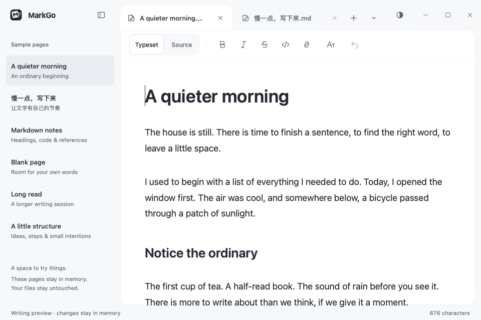

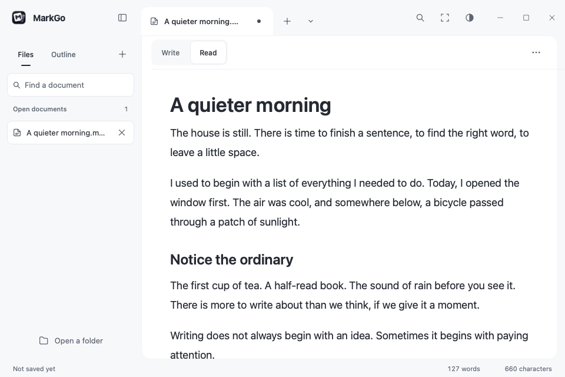

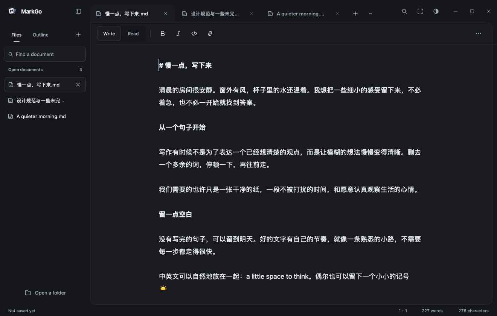

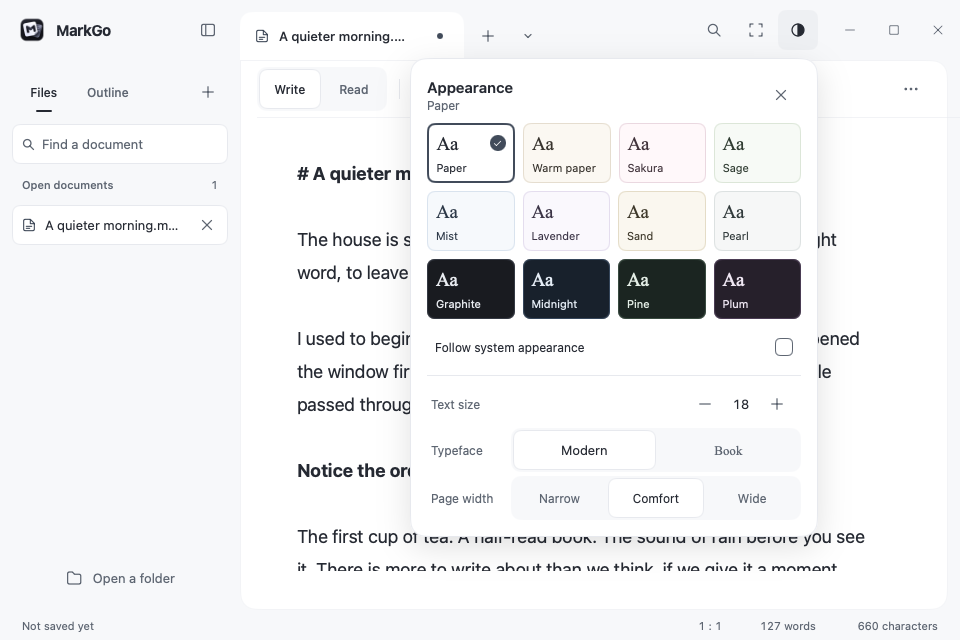

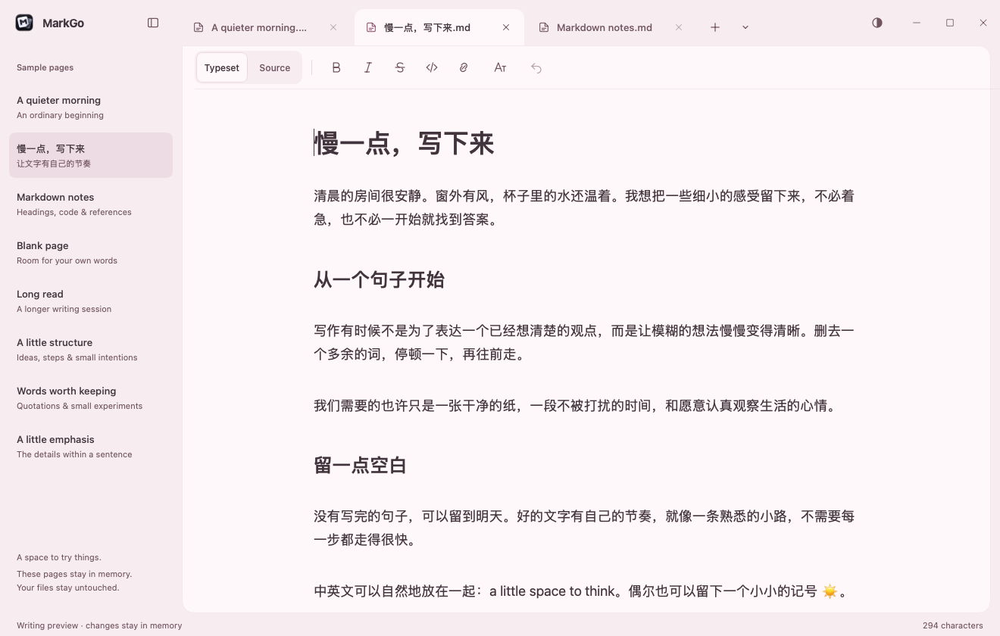

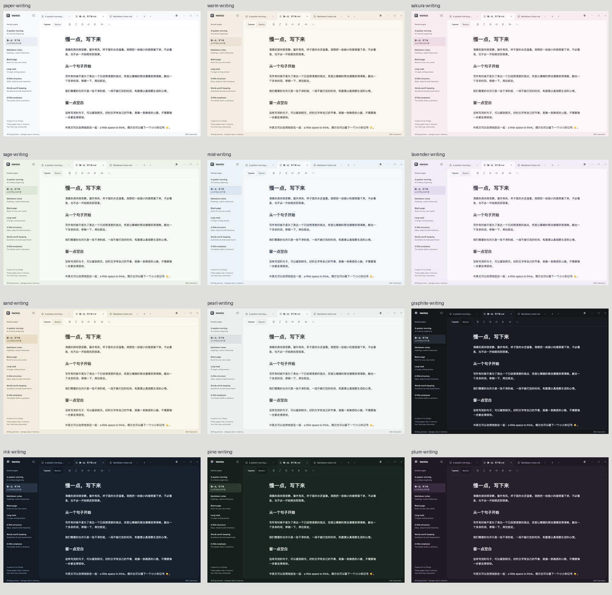

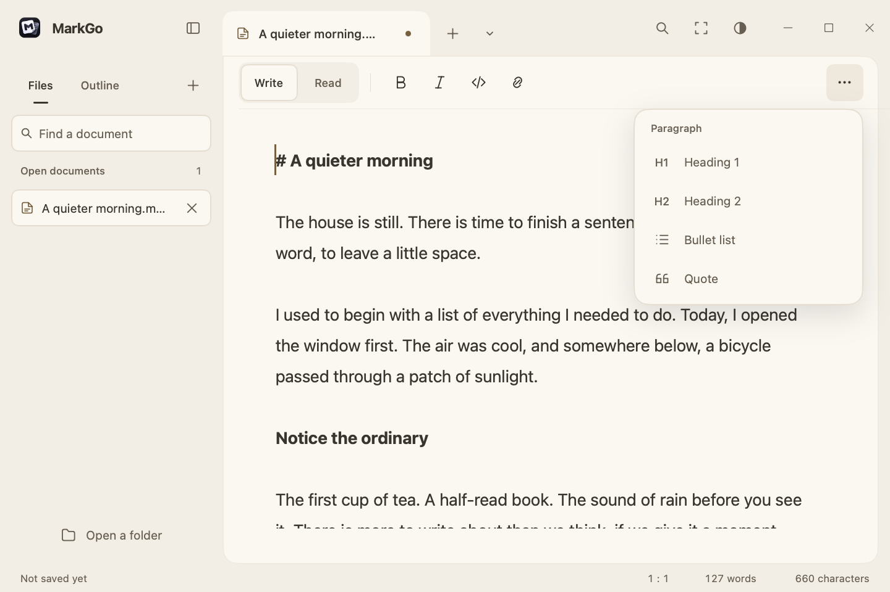

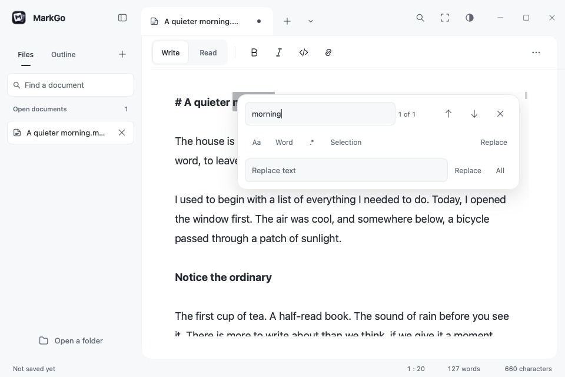

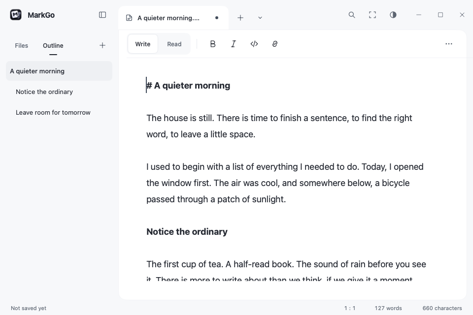

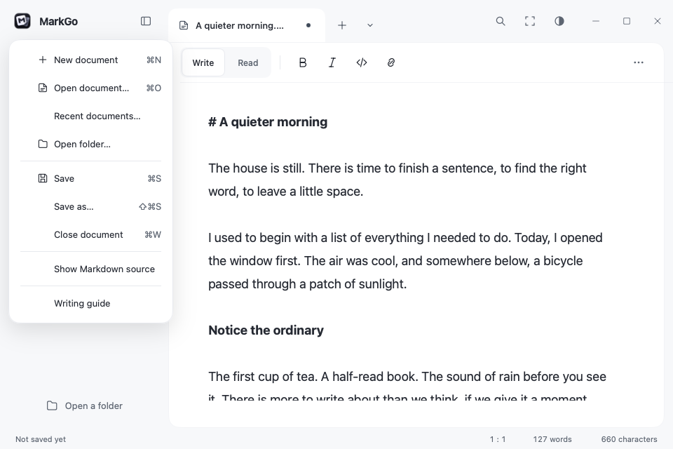

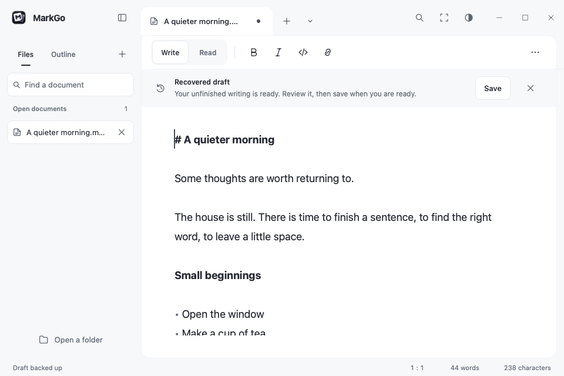

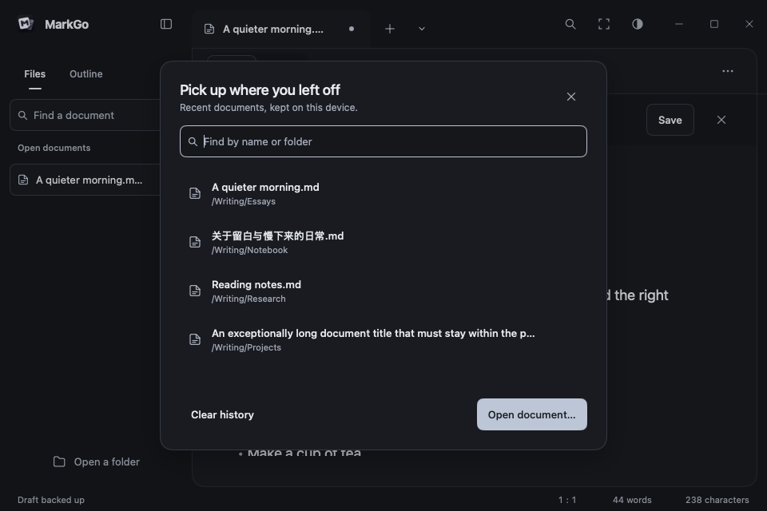

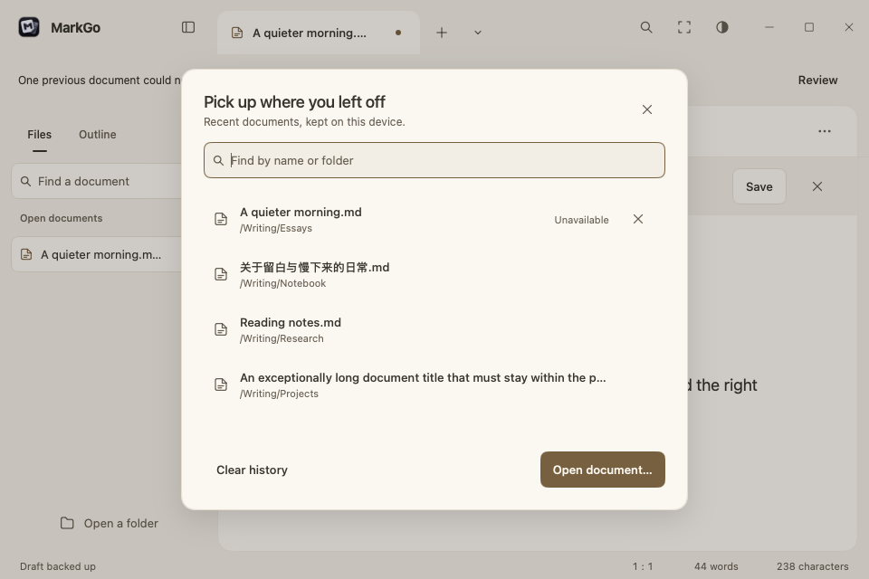

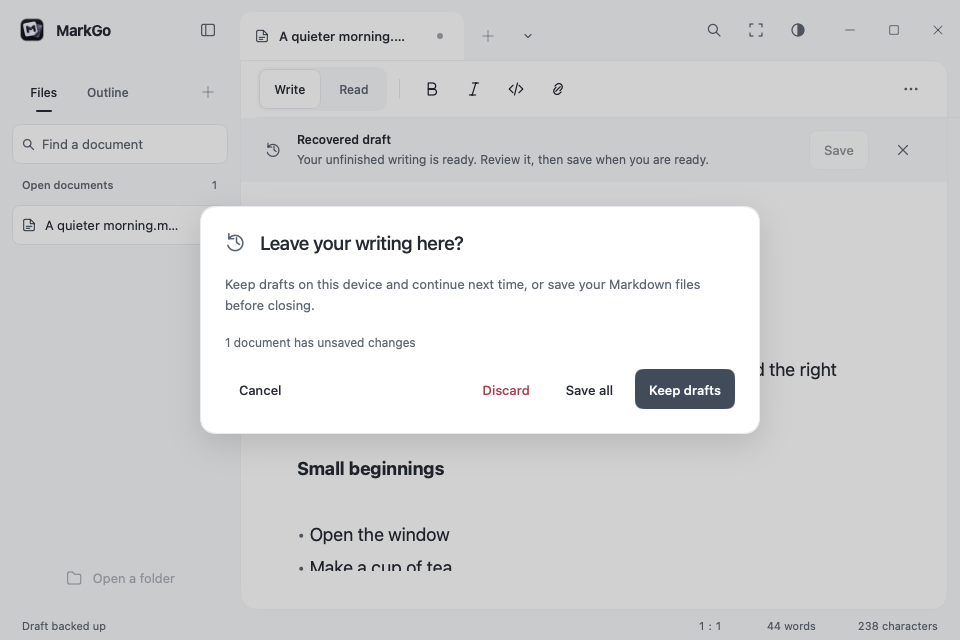

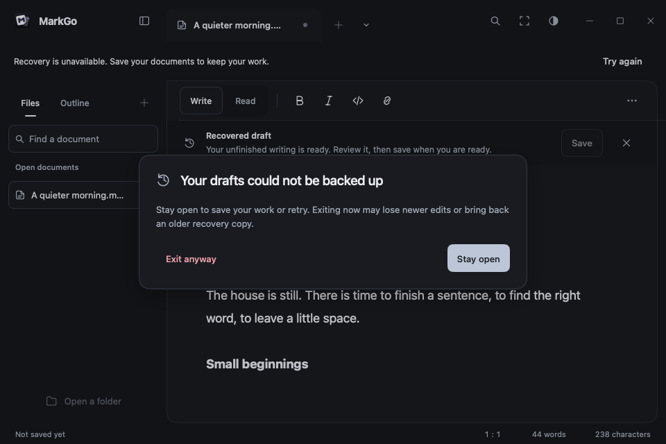

## Verification

Behavior tests also cover independent tab histories, close guards, context targeting, 24-document overflow, keyboard menu selection, resizing and reopening edited preview samples. Behavior tests cover theme and typography changes, system-following behavior, source/selection/scroll preservation, undo after dismissing a panel, all twelve preference round trips, keyboard theme selection, pointer cancellation, long document names, caption actions, interrupted panels, reduced motion, and non-overlapping control bounds at the minimum size and 1×/1.5×/2× scale. Inspect both reading and editing, all twelve themes, open popovers, find/replace, and focus mode. Native font, IME, window, and screen-reader verification remains a separate platform check. See [product polish verification](../development/product-polish.md) for the change comparison and evidence scope.
