# Native typesetting checkpoint

This is an isolated, runnable editing experiment, not a 1.0 beta release or the default document editor. It opens built-in samples and new in-memory pages only. Changes stay in memory and closing the preview discards them. It has no file associations, open/save callbacks, recovery store, appearance store or single-instance handoff.

## Try it

```sh
go run ./cmd/markgo-preview
go tool mygo build -skip-dmg ./cmd/markgo-preview
go tool mygo build -platform windows/amd64 -skip-installer ./cmd/markgo-preview
```

The standalone application is **MarkGo Writing Preview**, under `build/typesetting-preview/`. The ordinary MarkGo executable also accepts `--typesetting-preview` as its first argument, before any real workspace initialization. Normal launches retain the existing editor.

The shared workbench includes document tabs and a page toolbar. Closing a sample tab keeps its edits available in Sample pages; the plus creates an in-memory page, never a real file. Ctrl+Tab cycles open pages. Edit the English or Chinese sample directly. Drag from a heading into a paragraph, replace the selection, undo, switch to Source, type, switch back, and undo again. The Blank page and Long read samples exercise the same editor. `Cmd/Ctrl+Shift+M` switches views; `Cmd/Ctrl+0/1/2/3` applies a paragraph or heading. Appearance and sample-sidebar controls retain the writing selection. Switching views or pages cancels unfinished composition and restores the original selection with an explanatory notice.

The **A little structure** sample adds bullets, decimal steps and tasks. Return continues an item; Return in an empty item steps out one level. Tab/Shift+Tab moves an item and its descendants together. Backspace at an item start steps out too. The Paragraph style menu includes all three list kinds; `Cmd/Ctrl+Shift+8`, `+7`, and `+9` apply bullets, numbers and tasks. Click a checkbox or press `Cmd/Ctrl+Enter` at its item to toggle it. Every action shares Source mode's undo history.

The **Words worth keeping** sample adds simple quotations and fenced code. Return continues a quotation, and Return on an empty quoted line exits one level; Tab/Shift+Tab changes its depth. In code, Return retains indentation and Tab uses the named language's indentation convention (four spaces when unknown). `Cmd/Ctrl+Enter` or the header's Continue action moves to a paragraph after the block. The header changes the language tag or copies just the code body. Paragraph style and the context menu offer Quote and Code block; `Cmd/Ctrl+Shift+Q` and `+K` toggle them. Backspace at the first code line's start removes the fences in one undo step. Complete code selections copy their original Markdown fences; partial text selections copy text.

The **A little emphasis** sample adds bold, italic, strikethrough, inline code and links. The top row of Paragraph style offers all five, with `Cmd/Ctrl+B`, `+I`, `+Shift+X`, `+E` and `+K`. Selecting text applies or removes formatting; a caret inside a format removes that span. At an empty plain caret, a format arms the next insertion without adding placeholder text. Escape, changing pages or leaving Typeset cancels that intent. Left/Right can move across a hidden delimiter without consuming a visible character, letting writing continue inside or outside a format.

`Cmd/Ctrl+K` opens a small Text/Address panel. Apply, Cancel, Remove and Escape return to writing. Editing a reference link changes only that occurrence into an explicit link, retaining its title and leaving the shared definition untouched. An unchanged link is not rewritten. Editing does not launch a browser. Whole-paragraph clipboard selections retain Markdown; partial selections copy displayed text.

## Changes in this checkpoint

| Before | After |
| --- | --- |
| Inline delimiters and link addresses were visible in Typeset | Parser-confirmed spans draw bold, italic, strike, neutral code chips and understated link underlines while preserving original source |
| Inline formatting was available only in source | A compact five-icon row, context menu and shortcuts share source edits, selection and undo |
| Link labels and destinations required source editing | A native two-field panel validates Markdown, preserves existing nested labels/titles, and returns focus after Apply, Cancel, Remove or Escape |
| Hidden marks could make edits consume the wrong side of a delimiter | Start/end affinity, paired-boundary cleanup, backtick extension and explicit caret affinity keep edits source-backed |
| Checking every global rich-text run made dense inline editing expensive | Paragraph-relative style signatures retain unchanged attributes; changed and composing paragraphs are verified against fresh projection in tests |
| Editable source uses one font size; larger headings are available in the separate reader | The preview directly edits headings and paragraphs with native variable-size text layout, a 720 DIP page, 18 DIP body text and 1.75 line height |
| Reading and source have different roles | Typeset and Source edit the same canonical `editor.Buffer`; view switches transfer the primary selection and retain history |
| No runnable source-preserving rich-text adapter | A rune-to-source-byte map hides top-level ATX prefixes and applies precise edits without Markdown serialization |
| A straightforward rich-text round trip rewrites unsupported syntax | Untouched code languages, tables, reference definitions, front matter and line-ending metadata stay intact; unsupported syntax remains visible |
| Rich text and source would normally have separate undo stacks | Native menu commands, typing bursts, paste and composition commits route to source history; one input-method commit is one step |
| Keyboard-event simulation alone misses direct desktop text-service calls | An application-owned `TextInputClient` handles direct UTF-16 replacements, preedit, cancellation, and unmark-before-commit ordering; richtext supplies shaped caret geometry |
| The ordinary application is the only executable | A separate preview entry and bundle identifier allow sample-only inspection without touching the real workspace |
| Existing workbench appearance and motion | The preview reuses Paper, Warm paper, Graphite, custom titlebar, reversible sidebar motion, quiet hover feedback and small popover transitions; no page entrance motion |
| First prototype screenshots had tight body lines and an initial zero character count | Corrected line height and initialized statistics, then captured the rendered states again |
| Every input rebuilt a per-rune source map, reparsed all Markdown and reset the rich-text document | Incremental parsing and line records update the affected source region; precise display replacements retain unchanged paragraph layouts |
| Every source version invalidated all paragraph styles | Ordinary typing retains style caches; heading-level and paragraph-count changes still invalidate them |
| Preedit attributes were discarded as a side effect of resetting the document | Commit and cancellation explicitly clear preedit underlines, including unchanged-text composition |
| Lists were literal Markdown in the typesetting experiment | Parser-confirmed bullets, numbered items, tasks and nested text have hanging indents and native editable content |
| Native rich-text numbering starts at 1 and changes notation at deeper levels | Source-derived decimal ordinals retain arbitrary starts and count literal complex siblings without rewriting written numbers |
| List continuation and nesting were unavailable in Typeset | Return, empty-item exit, Tab/Shift+Tab, start-of-item Backspace and subtree indentation update canonical source in one undo step |
| Task markers were text | Original 18 DIP checkboxes have non-overlapping 40 DIP targets, a 100 ms neutral hover and 90 ms press; clicking preserves the writing caret and focus |
| Paragraph controls exposed headings only | Three list actions and original vector icons are available in the popup and context menu, with keyboard commands and source-mode history |
| Copying display text dropped hidden Markdown | Complete paragraph/item selections copy original syntax; partial sentences copy plain text; keyboard, native menu and context-menu paths agree |
| Text-service hit testing had no list inset | UTF-16 hit testing shares the displayed hanging indent, including room for long decimal markers |
| No sample exercised lists and their editing edges | A sixth sample, list behavior tests, expanded differential fuzzing and 27 additional rendered states cover these interactions |
| Quote prefixes were literal text | Simple parser-confirmed quotations show neutral rules and nested hanging insets, including lazy continuations and empty trailing markers |
| Quotation edits required manual prefixes | Return, empty-line exit, paste, Tab/Shift+Tab and start-of-line Backspace edit source prefixes with necessary separators |
| Code fences were ordinary displayed paragraphs | A visible-paragraph map hides paired fences; an empty block has a virtual caret without changing source merely to display it |
| Code shared prose typography | Code uses a quiet rounded surface, 90% monospace type, preserved indentation and wrapping in all three palettes |
| No code-specific controls | A 44 DIP header provides language editing, Copy and Continue, original vector icons, 40 DIP targets and restrained hover/press feedback |
| Language edits and leaving code required Source mode | A self-drawn popup validates language names, preserves trailing info, and restores writing focus; Continue and Cmd/Ctrl+Enter return to prose |
| Cross-boundary or literal-fence edits could leave broken delimiters | Paired changes join the same source transaction, preserve reversed-selection undo, and extend fences around literal fence content |
| Text-service mapping only accounted for headings and lists | Quote and code insets, monospace sizing and hidden paragraphs also participate in UTF-16 selection and wrapped hit testing |
| The sample rail assumed six visible pages | Seven samples share a scrollable rail, with the newly selected page revealed at narrow sizes |
| Coverage stopped at lists | Quote/code behavior, header cancellation/focus, native-client geometry, line endings, long documents, fresh-parse fuzzing, benchmarks and 36 new rendered states extend the evidence |

## Engineering decision

Continue the source-preserving native richtext adapter experiment. Keep it out of the real document lifecycle until the remaining gates pass.

| Approach | Evidence and tradeoff |
| --- | --- |
| Extend `ui/editor` block layout | The pinned editor has one font and line-height model. Variable-height blocks would require changes throughout wrapping, hit testing, scrolling and input geometry in the dependency. Existing source behavior remains useful as the canonical buffer and fallback view. |
| Serialize `richtext.ParseMarkdown` | Rejected: the earlier probe lost code language, rewrote references, and converted tables/front matter. No-op loading must not rewrite a file. |
| Project source into native richtext | Selected for this checkpoint. Reuses shaping, continuous pointer selection, wrapping and caret layout while keeping source authoritative. Requires explicit source maps and input/history adapters; these are exercised here, not assumed. |

`internal/mdeditor/typesetting*.go` implements the adapter. `Document` is disposable display state, including staged preedit. The source buffer changes only when an edit is committed. `FromSource` patches display text without editing source or clearing source history. Header commands, native Edit-menu commands and clipboard paste use that same history. Paste reads plain text rather than importing HTML/RTF attributes. Unsupported rich-format commands show feedback rather than creating formatting that cannot be saved in Markdown.

The projection retains the pinned parser's incremental document and a compact source/view record per physical line. Unchanged lines retain their rune counts. Every update reconciles top-level block kinds, since a fence or front-matter edit can change distant headings. UTF-8 replacements stop at rune boundaries. Ordinary text edits do not invalidate all paragraph styles or replace the whole rich-text document. This is not constant-time editing: source/display strings, downstream offsets, block reconciliation and some native text-service queries still involve document-wide work.

List metadata is derived from the same parser. Paragraph indentation supplies the editable text layout; custom native markers supply Markdown numbering and checkboxes without importing rich-text list serialization. Necessary blank separators prevent an empty nested dash from becoming a Setext underline, and allow a non-1 ordered child to begin a new list. Checkbox input explicitly leaves the parent text-selection handler out of its press while retaining the base button's cancellation behavior. Completed tasks use muted ink; the document never moves or fades when a checkbox changes.

Quote/code metadata is also parser-derived. Physical source records and visible paragraph indices are separate, so fence lines are absent from native text selection while their original bytes remain authoritative. Empty fences reuse a virtual display paragraph; only the first actual edit adds a body line. Inserting a literal closing-fence run extends both delimiters. Selecting across one fence removes the surviving partner in the same source-owned transaction. Code tools act through source edits; neither rich-text serialization nor a second undo stack is introduced. Quoted lists/headings/code, alerts and indented code remain literal in this checkpoint.

Inline metadata contains sparse hidden byte intervals and source spans per affected physical line, rather than a per-character source map. A selection begins after an opening mark and ends before a closing mark; an explicit source caret can retain either side. Deleting a complete formatted phrase removes empty wrappers, and crossing one boundary removes its surviving partner in the same transaction. Native text-service hit testing shares the renderer's typography, including bold, italic and code padding. Cached relative style signatures avoid enumerating global text runs on each input; a source paragraph edit or preedit clears the affected cache entries, including equal-length replacements.

Native input methods can call `TextInputClient` without `ObserveInput`. The adapter therefore owns that client rather than relying on keyboard observations to identify composition. Preedit replaces display text only. Cancellation restores the selection and source; confirmation commits once. An immediate final replacement after Unmark replaces that exact commit only if the source version and native range still match. Typing bursts similarly merge only the adapter's own latest version at the same caret; navigation, commands and IME break the burst.

## Evidence

Behavior tests cover forward and reversed cross-block selections, pointer drag, deletion/joining, Enter at heading start/middle/end, select-all deletion, emoji and CJK offsets, plain-text paste from a mixed HTML/text clipboard, native menu undo/redo, shared source-mode history, direct native-client calls, composition cancellation and unmark/commit ordering. Unchanged replacement tests guard against accidentally undoing earlier writing. Long-document tests use more than 100,000 Unicode characters and verify typing/undo at the start, middle and end, including source preservation and caret stability. Incremental projection tests compare text, line records and source/view offsets with a fresh parse after edits and undo. A 20-second local fuzz run completed 182,604 cases without a mismatch, including fences, front matter, HTML, nested blocks and Unicode replacements.

List tests additionally cover typed markers, split/continued/empty items, reversed multi-item selections, whole subtrees, continuation-line joining, non-1 starts, literal complex siblings, nested numbering, task click cancellation, retained typing focus, native menu commands, clipboard syntax, task composition, 14/18/24 DIP hit geometry, nine-digit markers, LF/CRLF save captures and long-list caret stability. Fresh-parse comparisons now include list ownership, indentation, checked state and ordinals. A 15-second list-focused fuzz run completed 60,938 cases without a mismatch.

Rendered evidence comes from the actual Go view through `ui.NewTester`, not a browser or design mockup. The screenshot matrix has **141 states**: 47 scenes × three palettes. It retains the 35 writing/list/quote/code scenes and adds inline overview, narrow overview, source, selection, formatting menu, link editing/creation/error, 24 DIP typography, preedit, empty page and unsupported-selection feedback. Writing, Chinese, list, quote/code and inline overviews use 1320×840; other scenes use 960×640. All states were captured and inspected through 24 contact sheets and full-size checks of the new controls.

Inline tests cover nested marks, source-preserving edits, paired-boundary deletion, backticks, reversed selection, partial format removal, empty-caret intent, keyboard/native-menu commands, plain/Markdown clipboard boundaries, reference-link isolation, title preservation, link validation/focus, LF/CRLF capture, cached-versus-fresh attributes and unchanged-text composition. Direct text-service tests check wrapped mixed styles with CJK and surrogate pairs at 14/18/24 DIP and 1×/1.5×/2× scale. The projection fuzz oracle now includes sparse inline spans and hidden intervals; the final 20-second run completed **59,035 cases** without a mismatch.

The same inline sample on merged main `5929f09` and this checkpoint:


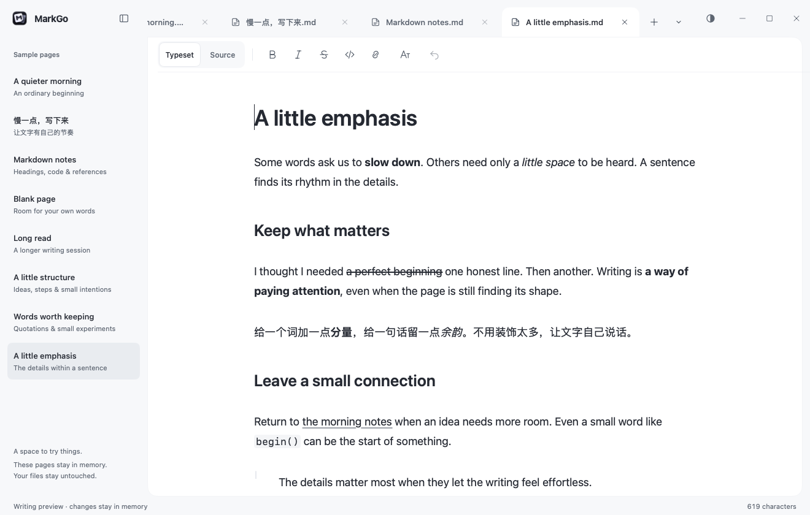

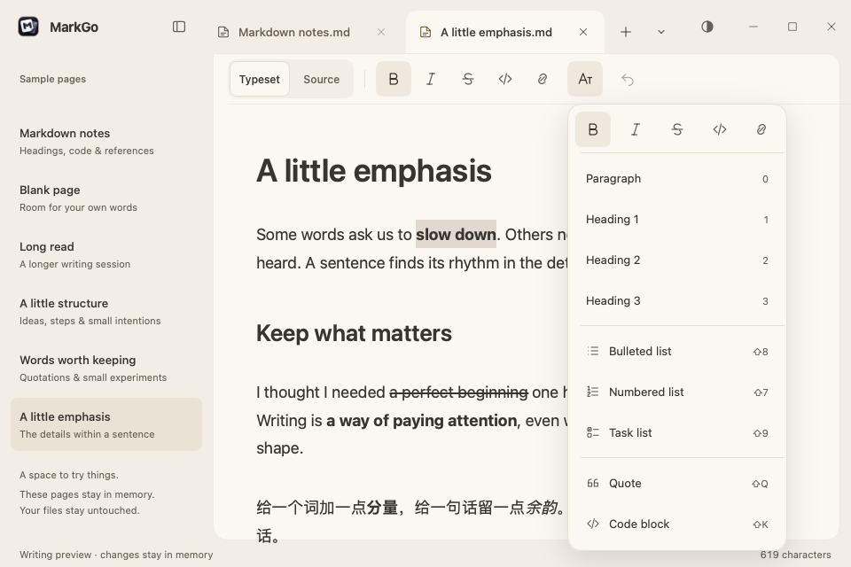

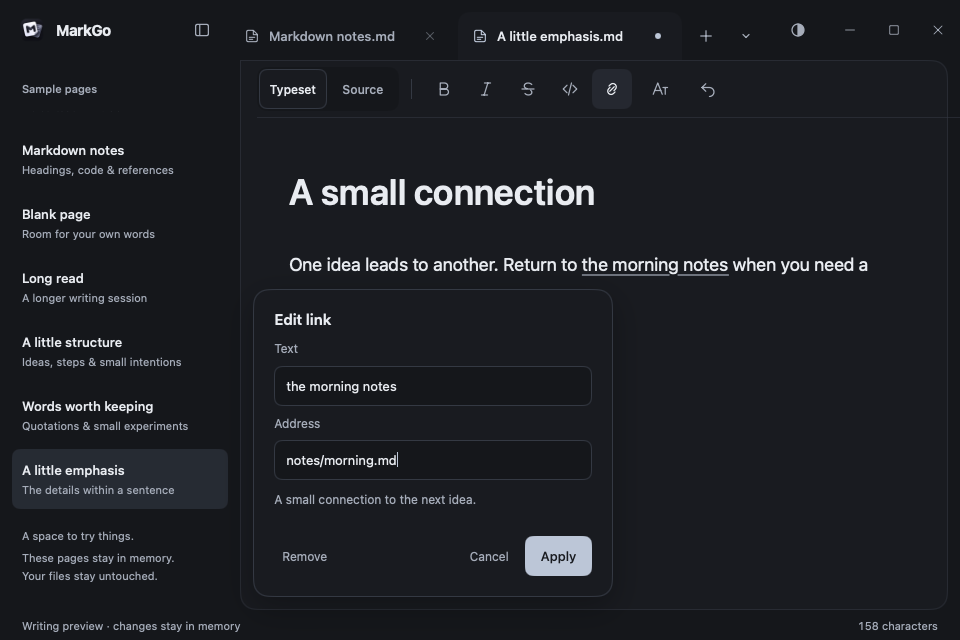

Quote/code tests cover continuation, empty exit, lazy quotes, nested indentation, paired and unfinished fences, virtual empty input, literal fence typing/paste, crossing multiple code boundaries, reversed-selection undo, language suffix preservation, clipboard ranges, header cancellation/focus, source-mode history, LF/CRLF bytes and long-document caret stability. Direct native-client tests check surrogate pairs and wrapped quote/code hit geometry at 14/18/24 DIP type and 1×/1.5×/2× scale. The fresh-parse oracle also compares visible paragraph indices, physical block ownership and fence ranges. A 20-second fuzz run completed **95,048 cases** without mismatch.

The same quote/code fixture on merged main `9367a71` and this checkpoint:


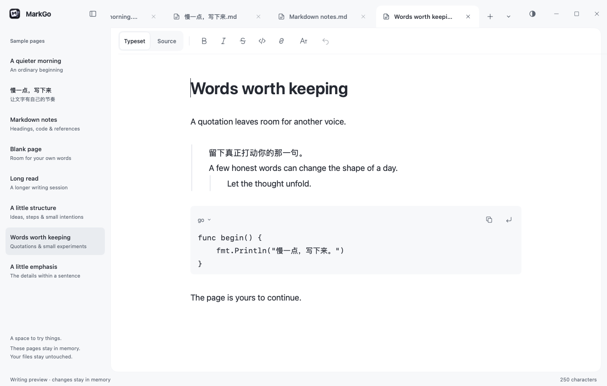

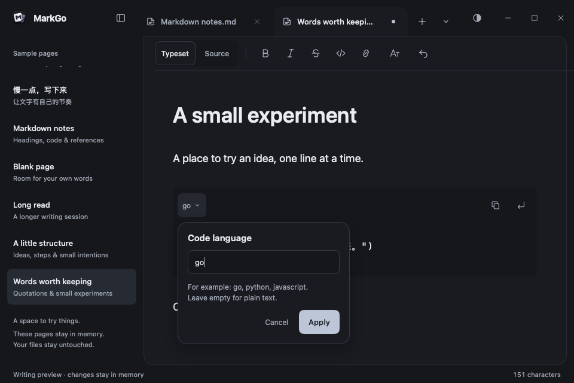


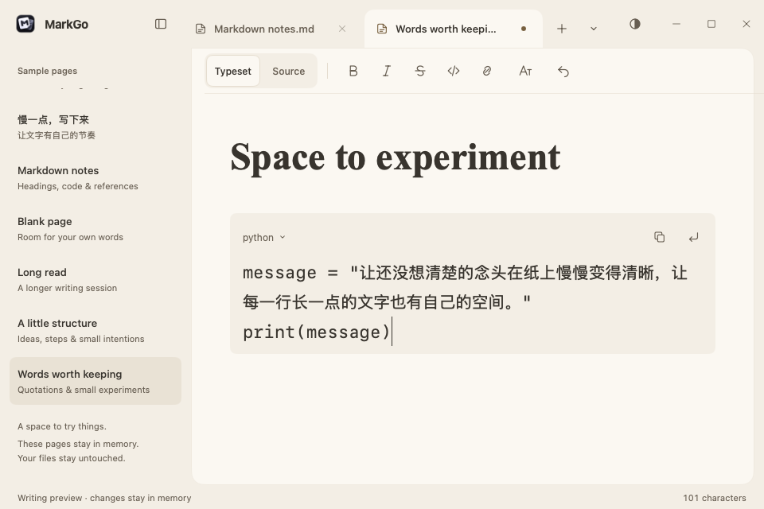


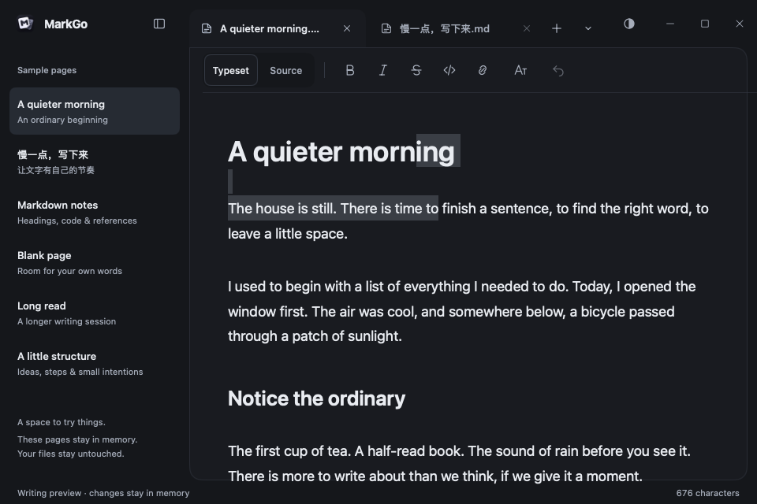

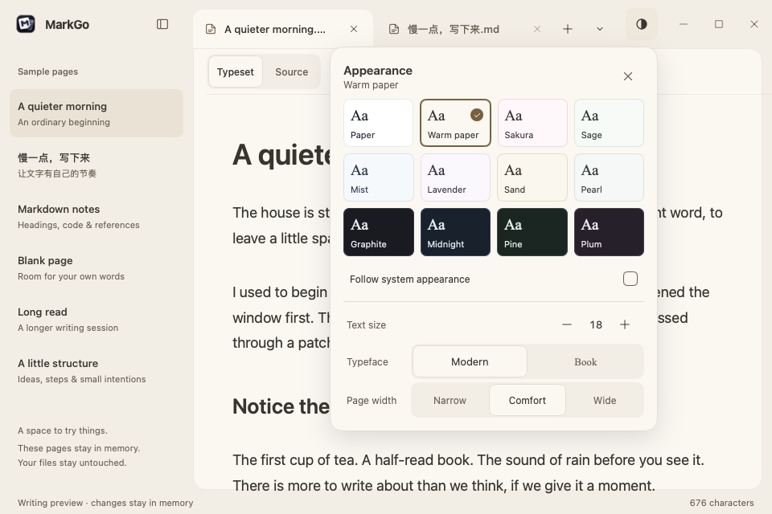


The same in-memory list fixture rendered by merged main `b1d63c2` and this checkpoint:

| Before | After |
| --- | --- |
|  | 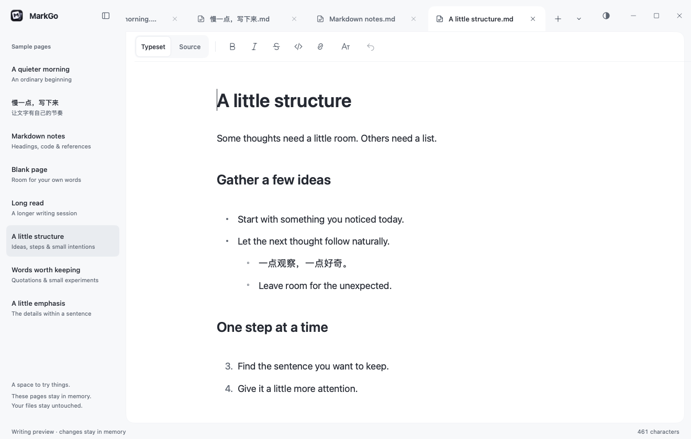 |

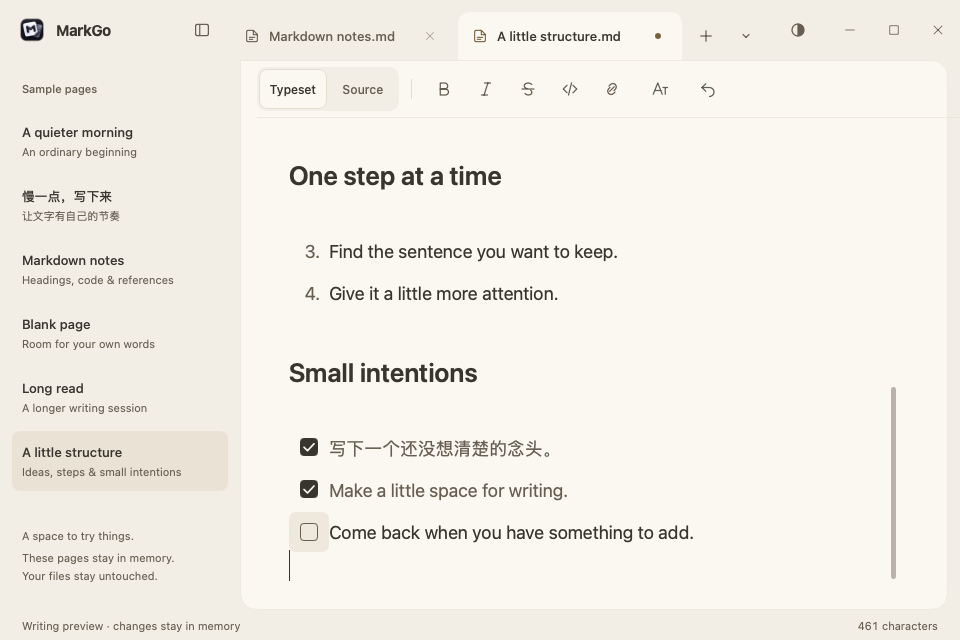

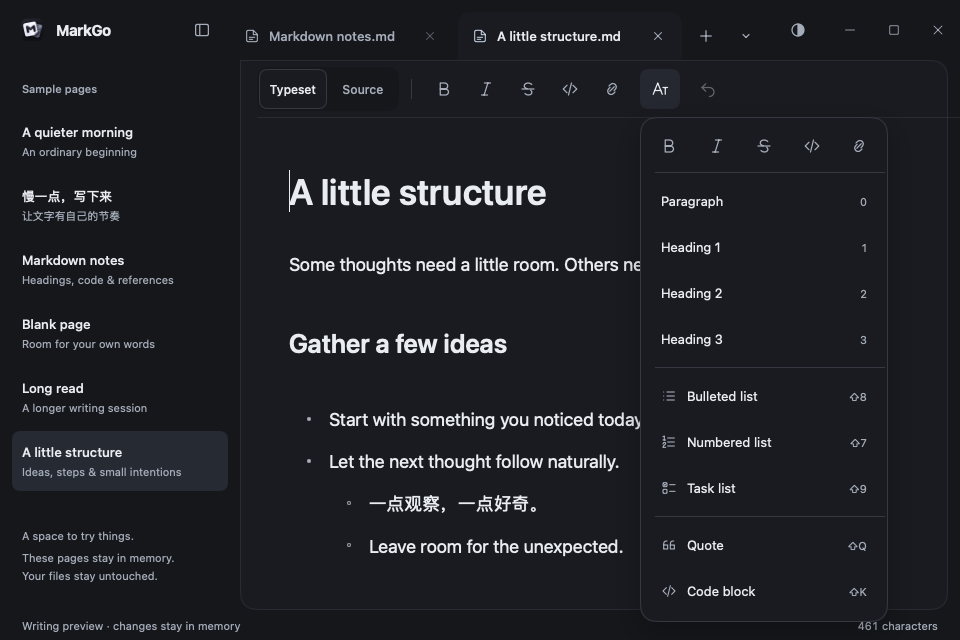


On an Apple M2 Max, Go 1.27.4, CGO disabled, fixed-workload benchmarks compare the merged baseline `b8f6526` with the incremental implementation. Each result below is the median of three runs of 200 operations; MB means decimal megabytes allocated per operation. An edit cycle inserts `中🙂` and undoes it, restoring exactly the same fixture each time. The complete preview benchmark includes the workbench and word-count updates.

| Workload | Before time / allocation | After time / allocation |
| --- | --- | --- |
| Editor, continuous input, 100,000+ characters | 7.43 ms / 16.15 MB | 3.37 ms / 1.31 MB |
| Editor, start edit + undo | 10.18 ms / 33.70 MB | 1.59 ms / 5.43 MB |
| Editor, middle edit + undo | 14.47 ms / 33.90 MB | 5.15 ms / 4.43 MB |
| Editor, end edit + undo | 17.97 ms / 33.82 MB | 7.88 ms / 2.87 MB |
| Complete preview, middle edit + undo, 111,317 characters | 15.95 ms / 21.93 MB | 9.73 ms / 4.93 MB |

Raw [before](benchmarks/typesetting-2026-11-13-before.txt) and [after](benchmarks/typesetting-2026-11-13-after.txt) output is retained for comparison. These are CPU/headless averages, not desktop input latency, p95, GPU frame time or a native performance acceptance result. They also do not establish bounded live-heap use or long single-paragraph performance.

The list checkpoint repeats the same fixed workloads against merged main `b1d63c2` on the same machine/toolchain, without concurrent build jobs. Medians of three × 200 operations remain close: ordinary continuous input is 3.29 → 3.25 ms with 1.31 MB allocated; complete-preview edit/undo is 9.29 → 9.30 ms with 4.93 MB allocated. A separate 3,500-task, 100,000+ character fixture takes 19.87 ms and 6.71 MB per edit/undo cycle. This measures a different, list-heavy workload and is not an improvement claim. Raw [list baseline](benchmarks/lists-2026-11-13-before.txt) and [list checkpoint](benchmarks/lists-2026-11-13-after.txt) outputs are retained.

The quote/code checkpoint compares merged main `9367a71` with this implementation, on the same M2 Max and Go 1.27.4, with no competing build/test jobs. Arithmetic means of three runs × 200 operations:

| Fixed workload | Before | After |
| --- | --- | --- |
| Ordinary edit/undo at start | 1.62 ms / 5.43 MB | 1.75 ms / 5.44 MB |
| Ordinary edit/undo in middle | 5.06 ms / 4.44 MB | 5.03 ms / 4.44 MB |
| Ordinary edit/undo at end | 8.41 ms / 2.88 MB | 7.90 ms / 3.02 MB |
| Continuous single-character input | 3.25 ms / 1.31 MB | 3.38 ms / 1.31 MB |
| Complete-preview edit/undo | 9.68 ms / 4.93 MB | 9.46 ms / 4.94 MB |
| 1,800 quote/code groups, 108,000 characters | 5.25 ms / 4.84 MB | 5.82 ms / 4.43 MB |

The last row uses identical source on both revisions; the baseline displays the quote/fence syntax literally, while the new revision draws structured blocks and controls. It measures the cost of the new behavior, not a speed improvement. All values remain headless CPU measurements, not native latency acceptance. Raw [quote/code baseline](benchmarks/blocks-2026-11-13-before.txt) and [quote/code checkpoint](benchmarks/blocks-2026-11-13-after.txt) outputs are retained.

Local `go test ./...`, module consistency, Go vet, MyGo vet for both entries, staticcheck and macOS/Windows preview packaging are checked for this checkpoint. The local `make` shim is blocked by an unaccepted Xcode license, so its component checks are run individually; CI runs the actual Make target and race detector.

For the inline checkpoint, the same fixed workload ran on `5929f09` and this change: Apple M2 Max, Go 1.27.4, 200 cycles × three runs, medians below. The dense fixture has 1,600 groups and 145,600 Unicode characters. The baseline renders inline syntax literally, so its result measures the cost before adding the new behavior, not equivalent typesetting.

| Workload | Baseline | Inline checkpoint |
| --- | ---: | ---: |
| Ordinary edit/undo — start | 1.56 ms / 5.44 MB | 2.09 ms / 5.44 MB |
| Ordinary edit/undo — middle | 4.75 ms / 4.44 MB | 5.34 ms / 4.44 MB |
| Ordinary edit/undo — end | 7.67 ms / 3.02 MB | 8.09 ms / 3.02 MB |
| Ordinary headless typing | 3.25 ms / 1.31 MB | 3.53 ms / 1.31 MB |
| Complete-preview edit/undo | 9.32 ms / 4.94 MB | 9.58 ms / 4.94 MB |
| Dense inline edit/undo | 5.72 ms / 4.82 MB | 10.04 ms / 8.09 MB |

Raw [inline baseline](benchmarks/inlines-2026-11-13-before.txt) and [inline checkpoint](benchmarks/inlines-2026-11-13-after.txt) outputs are retained. These are headless CPU measurements, not native input latency. Dense inline projection still allocates more than ordinary text and needs sustained native-session profiling before integration.

**Native acceptance is still pending.** The Roundtable desktop screenshot request for `dev.markgo.writing-preview` returned “请在主机上打开指定应用，并保留一个运行实例。” No real desktop screenshot, OS candidate-window check, Windows drag/Snap/DPI check or OS clipboard acceptance is claimed. Calling the native client directly in tests verifies the adapter contract, not the behavior of an installed input method.

## Limits and next gates

- Structured presentation covers top-level ATX headings, ordinary lists/tasks, simple quotations (up to eight levels), top-level fenced code, emphasis/strong/strike, single-line inline code and explicit/reference links. Optional closing heading marks, quoted lists/headings/code, alerts, indented code, compact same-line nesting, block-first complex items, front matter, images and tables remain literal Markdown. Code wraps and uses neutral monospace text; syntax highlighting and horizontal code scrolling are not implemented.
- Inline commands operate within one physical paragraph; selections crossing half of another format explain the boundary. Existing multiline emphasis is displayed, but multiline inline code/links, automatic URL opening, decoded escape/entity presentation and advanced link syntax editing remain source operations. Original bytes are retained when these forms are left unchanged.
- Physical source lines remain separate display paragraphs; soft-line-break paragraph fusion and blank-line spacing need a deliberate model before expanding block support.
- Incremental projection and retained layout now reduce ordinary typing costs. Full-string snapshots, offset updates, native text-service range queries, long single-paragraph behavior and sustained live-heap use still need profiling. Precise paragraph anchoring across mode switches, native text-service hit testing, multi-line preedit and actual desktop input latency remain integration gates.
- Current history is in memory; this preview does not save or recover edits. The production editor's recovery implementation is separate and unchanged.
- Next: image insertion and basic GFM table editing through the same source model. Native Windows/macOS IME and selection acceptance remains required before integration with ordinary documents. Export follows the [beta delivery plan](beta-delivery.md). Do not promote this adapter to ordinary files just because the sample looks finished.
