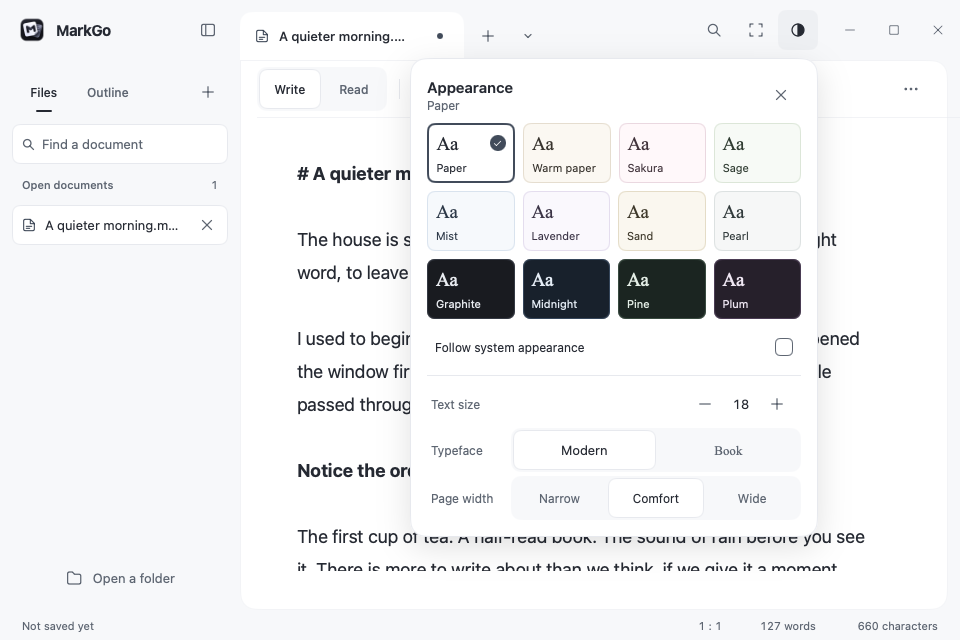
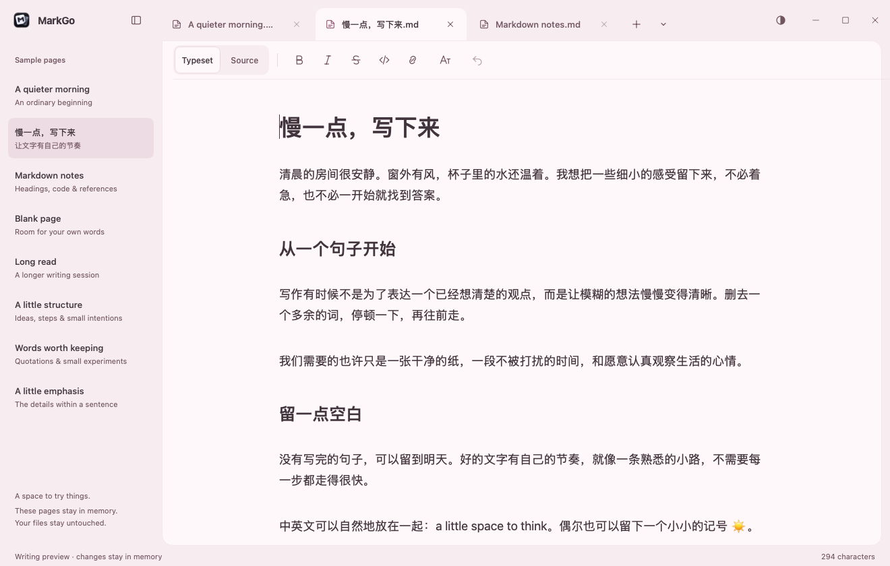
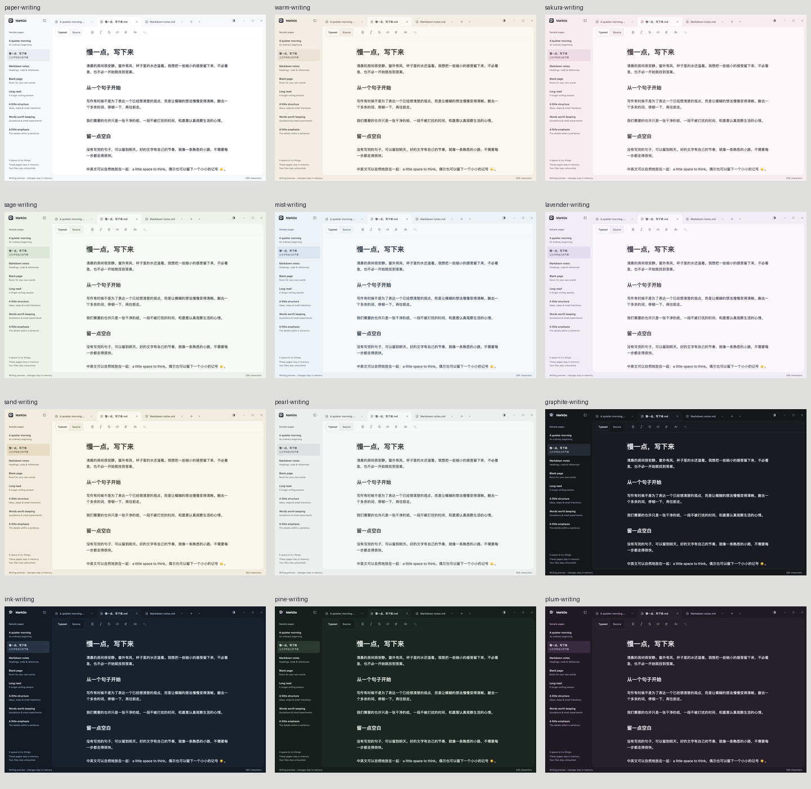
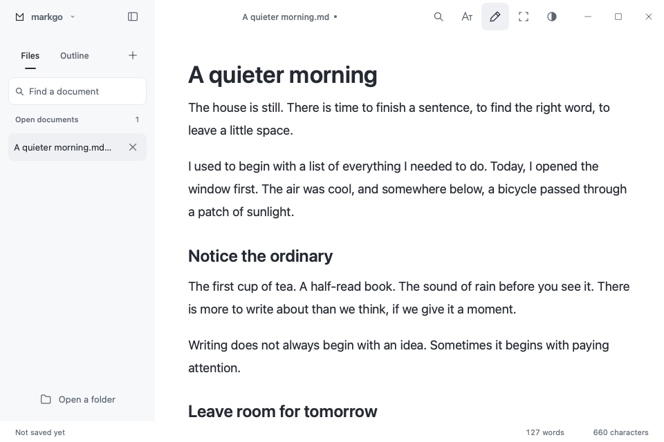
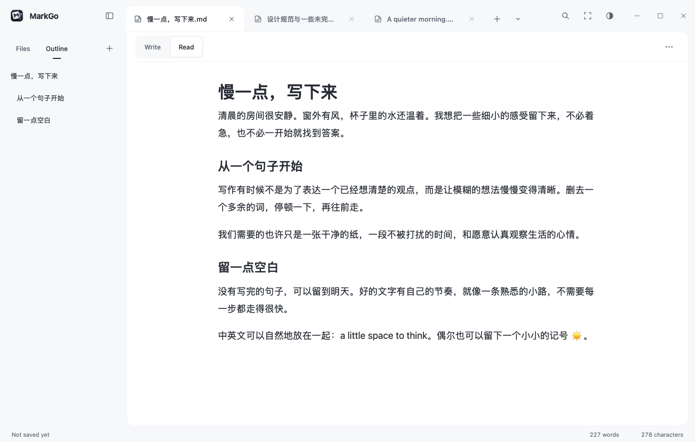
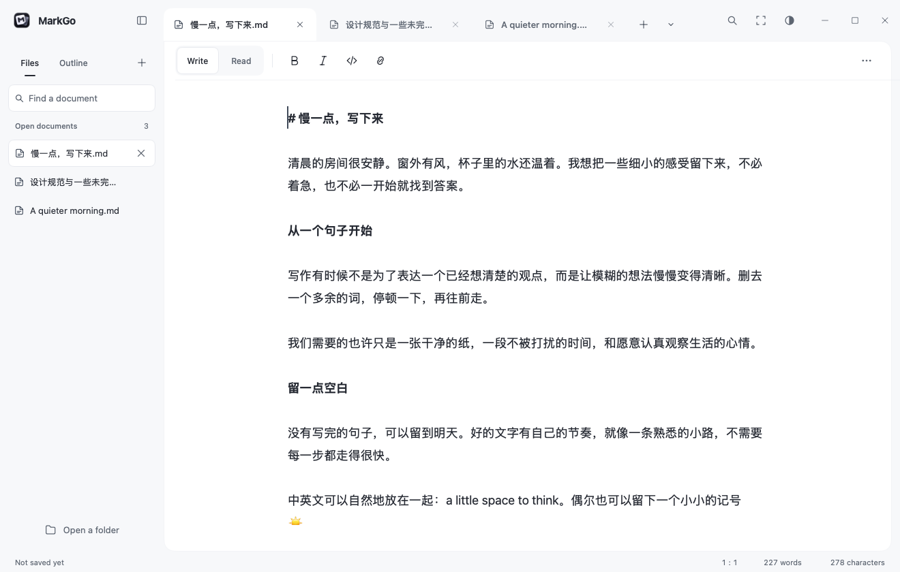

# Product detail polish

This pass concentrates on the existing native interface. It retains the latest application icon, the ordinary app's file/recovery lifecycle and the sample-only boundary of Writing Preview. It adds no editor syntax, AI integration or WebView. Screenshots below are actual Go-view renders, not native desktop acceptance.

## Visual and interaction changes

| Area | Before | After |
| --- | --- | --- |
| Workbench structure | A document title beside a flat sidebar/editor split | Document tabs over a distinct paper surface, a separate page toolbar, 60 DIP title bar, 240 DIP navigation and a restrained outer gutter |
| Brand | Small line symbol and lowercase wordmark | Existing application icon at 28 DIP and a clearer 15 DIP MarkGo name |
| Document tabs | Open files discoverable only in the sidebar | 224 DIP tabs with close/dirty feedback, full-path tooltips, context actions, new document and a bounded overflow menu; duplicate names include folders |
| Tab navigation | No visible tab navigation | Ctrl+Tab cycling, automatic reveal after navigation/resizing, independent selection/scroll/undo and existing unsaved-close guards; preview sample tabs reopen with edits intact |
| Page toolbar | All writing actions lived in the title bar or popovers | Write/Read or Typeset/Source beside directly reachable formatting, with labeled paragraph actions instead of a duplicate icon strip, detailed popovers and uncluttered global actions |
| Theme catalog | Three themes; preference/native appearance switches maintained separate ID lists | Twelve complete palettes; one catalog resolves persistence and OS light/dark appearance |
| Contrast | Secondary ink could become too faint on pressed surfaces; several theme-dependent widget colors inherited OS defaults | Text/secondary ink verified at 4.5:1 or higher on page, rail, hover and pressed surfaces; primary, focus and semantic colors checked too; tooltips and scrollbars use resolved palette colors |
| Appearance gallery | Three tall cards and unrelated typography buttons | Four columns of compact paper samples, a selected check, current theme name, explicit close action and recessed typeface/width segments |
| Keyboard focus | Mouse choices worked; Tab could remain in the preview editor, and hidden panel controls could retain focus | Opening places focus in Appearance; Tab and Space/Enter operate themes; Close/Escape, anchor toggles and interrupted panel changes return appropriately without changing the writing selection |
| Buttons and icons | Separate implementations and inconsistent hover/press feedback | Shared 40 DIP targets, 8 DIP radius, 100 ms color transitions and 0.96 press response; 18 DIP workbench vectors |
| Floating surfaces | Several corner, border and shadow treatments | Shared 16 DIP corners, theme edges, light/dark shadow depth without stacking toolkit shadows and reversible 130/90 ms entrance/exit; document remains still |
| Sidebar and outline | Some 10 DIP helper text, 12 DIP filenames; outline lacked a pressed state | 13 DIP document/outline/sample titles, 11 DIP helper text, paper-colored file selection with readable icons, cleaner sample spacing, outline press feedback and full-title tooltips |
| Source/typeset switch | Two independent filled buttons | One recessed segmented control with a distinct selected surface and preserved click targets |
| Document menus | Dense rows and smaller panel corners | 40 DIP application-menu rows with the native keyboard model; document-menu surface follows the shared panel treatment |
| Search | Narrow mixed control treatments | 480 DIP panel, consistent 40 DIP fields/actions, clearer active options and shared feedback |
| Link and code language | Mixed field radii, subdued Apply, errors resembled hints | Consistent fields, 15 DIP headings, primary Apply actions and explicit error color; link validation marks the corresponding field; hint space reduces short-error movement |
| Recent and exit dialogs | Different button treatments and section spacing | 24 DIP panel padding, clearer section spacing, consistent primary actions and destructive text; recent rows also respond to pressing |
| Recovery and conflict notices | Generic platform-sized actions | Consistent 40 DIP actions and theme-aware surfaces while preserving save/reload guards |
| Footer | Tabular digits still changed neighboring groups' positions at digit boundaries | Reserved widths for caret, word and character counts |
| Maintenance | Visual logic duplicated across the workbench and editable popovers | `internal/writingui` owns presentation only; focus and rich-text input policy remain at call sites; user guide, theme tokens and regression coverage updated together |














## Reproduce rendered evidence

Run these with separate destinations so similarly named recovery and preview scenes cannot overwrite each other:

```sh
MARKGO_SCREENSHOT_DIR="$PWD/build/product-polish-review/rendered" CGO_ENABLED=0 go test ./internal/app -run '^TestProductPolishScreenshots$' -count=1
MARKGO_SCREENSHOT_DIR="$PWD/build/product-polish-review/rendered/preview" CGO_ENABLED=0 go test ./internal/app -run '^TestTypesettingScreenshots$' -count=1
MARKGO_SCREENSHOT_DIR="$PWD/build/product-polish-review/rendered/recovery" CGO_ENABLED=0 go test ./internal/app -run '^TestRecoveryScreenshots$' -count=1
MARKGO_SCREENSHOT_DIR="$PWD/build/product-polish-review/rendered" CGO_ENABLED=0 go test ./internal/app -run '^TestProductScaleScreenshots$' -count=1
MARKGO_SCREENSHOT_DIR="$PWD/build/product-polish-review/rendered" CGO_ENABLED=0 go test ./internal/app -run '^TestWorkbenchTabsScreenshots$' -count=1
MARKGO_SCREENSHOT_DIR="$PWD/build/product-polish-review" CGO_ENABLED=0 go test ./internal/app -run '^TestProductPolishMotion$' -count=1
```

The 389 rendered screenshots include all twelve palettes in thirteen gallery scenes: Chinese writing, appearance, maximum Book typography, ordinary editing, reading, find/replace, empty editing, outline, formatting, ordinary-app appearance, focus, document menu and empty recent history. The preview matrix covers 47 editing/overlay/error scenes in Paper, Warm paper and Graphite. Recovery covers its normal, empty, unavailable, conflict and exit/failure flows. Forty-eight multi-document views cover writing, reading, the minimum window and 24 open tabs in every theme. Eight additional renders inspect controls at 1.5× and 2× scale; a 50-frame recording shows actual UI transitions. Layout tests verify the theme controls at 1×, 1.5× and 2×, including non-overlapping targets at 960 × 640.

Behavior regressions check every palette's persisted settings and native appearance selection, source/selection/scroll preservation, pointer cancellation, keyboard activation, Escape/close focus, interrupted panels, undo, field-specific link validation, independent tab histories, guarded closing, overflow keyboard access, resizing and reopening edited preview samples. No fixture touches real user documents or preference stores.

## Acceptance boundary

The local `make` shim is blocked by an unaccepted Xcode license. Run the same formatting, module, Go/MyGo vet, Staticcheck and coverage-test commands directly with `CGO_ENABLED=0`; the repository CI runs `make check`, three-platform tests/builds, race detection and vulnerability analysis.

The configured desktop tool reported that `dev.markgo.writing-preview` must first be opened on the host with only one running instance. No native desktop acceptance was obtained through that tool. Native IME candidates, OS clipboard, real GPU timing, window dragging/resizing/Snap and screen-reader behavior remain separate checks. A packaged binary or these headless renders do not establish those outcomes, and this pass does not declare a 1.0 beta release.
